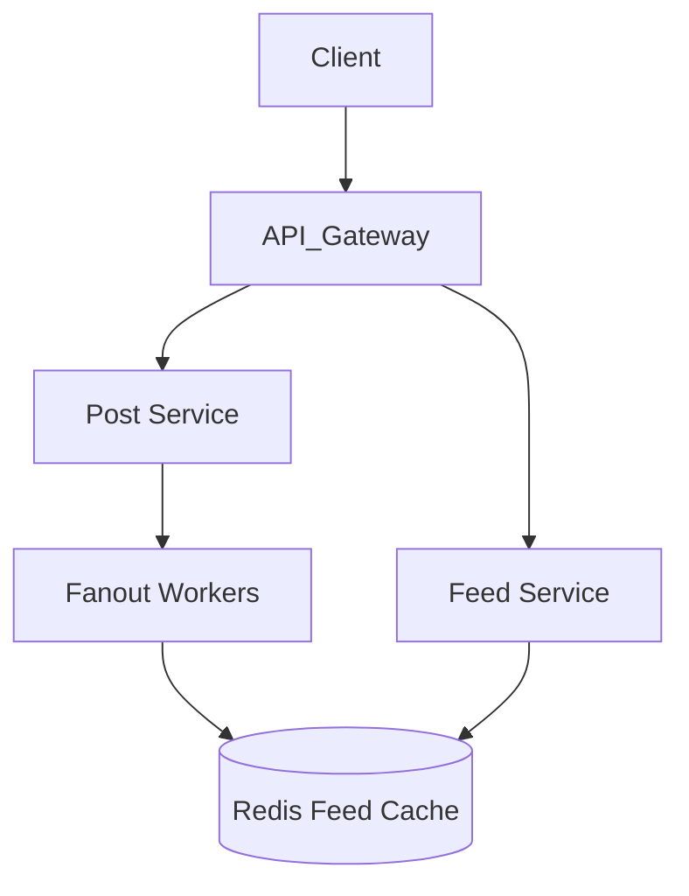

# Lesson 03: Design a Social Media Feed

## Learning Objectives
- Design a scalable news feed system (e.g., Twitter, Facebook).
- Understand the fanout process (Fanout on write vs Fanout on read).
- Discuss data models for social graphs.

## 1. Requirements
- **Functional:** Users can publish posts. Users can see a timeline of posts from people they follow.
- **Non-Functional:** Fast feed loading (<200ms). High availability.

## 2. Core Concept: Fanout
When a user publishes a post, how does it get into their followers' feeds?

**Approach 1: Fanout on Read (Pull)**
- When User A loads their feed, the system fetches all users they follow, gets their recent posts, and merges them.
- *Pros:* Simple. Good for inactive users.
- *Cons:* Extremely slow for users following many active people.

**Approach 2: Fanout on Write (Push)**
- When User A publishes a post, the system pre-computes the feed for all followers and pushes the new post into their feed caches.
- *Pros:* Feed loading is O(1) and very fast.
- *Cons:* "Justin Bieber problem". If a celebrity with 100M followers posts, computing 100M caches is very expensive.

**Hybrid Approach:**
Use Push for normal users. Use Pull for celebrities. When loading a feed, fetch the pre-computed feed and merge it with the celebrity pull-feed.

## 3. High-Level Architecture

## Summary & Checklist
- [ ] Explain Fanout on Write vs Fanout on Read.
- [ ] Discuss the hybrid approach for celebrity accounts.
