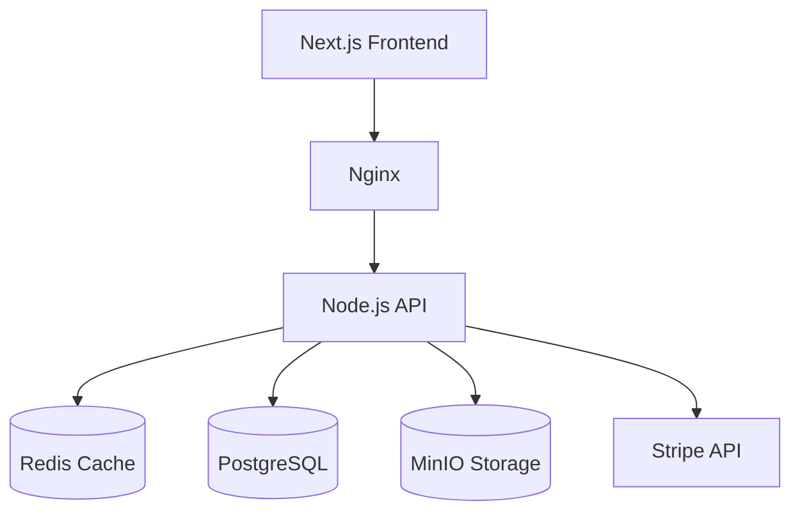

# Project 01: Full-Stack E-Commerce Platform

## Project Overview
Build a complete, production-ready e-commerce platform. This is not a toy project; it requires complex state management, secure payment processing, and an optimized backend.

## Tech Stack
- **Frontend:** Next.js (App Router), React, Tailwind CSS, Zustand or Redux.
- **Backend:** Node.js, Express (or NestJS).
- **Database:** PostgreSQL (with Prisma ORM), Redis (for cart caching).
- **Storage:** MinIO or AWS S3 for product images.
- **Infrastructure:** Docker, Docker Compose, GitHub Actions.

## Requirements

### User Stories
- **Customer:** Can browse products, filter/sort, add to cart, checkout via Stripe, view order history.
- **Admin:** Can manage inventory, upload product images, view sales dashboard, manage user roles.

### Core Architecture

### Database Schema (Prisma)
You will need models for: `User`, `Product`, `Category`, `Order`, `OrderItem`.
Think carefully about how to handle prices (use integers/cents, not floats) and inventory locking during checkout.

## Milestones
1. **Setup:** Docker compose file with Postgres, Redis, and MinIO.
2. **Auth:** Implement JWT authentication and Role-Based Access Control (Admin vs User).
3. **Catalog:** Product CRUD, Image upload to S3/MinIO.
4. **Cart:** Implement a high-performance cart using Redis.
5. **Checkout:** Integrate Stripe webhook for payment confirmation.
6. **Deployment:** Setup CI/CD and deploy to a VPS.
