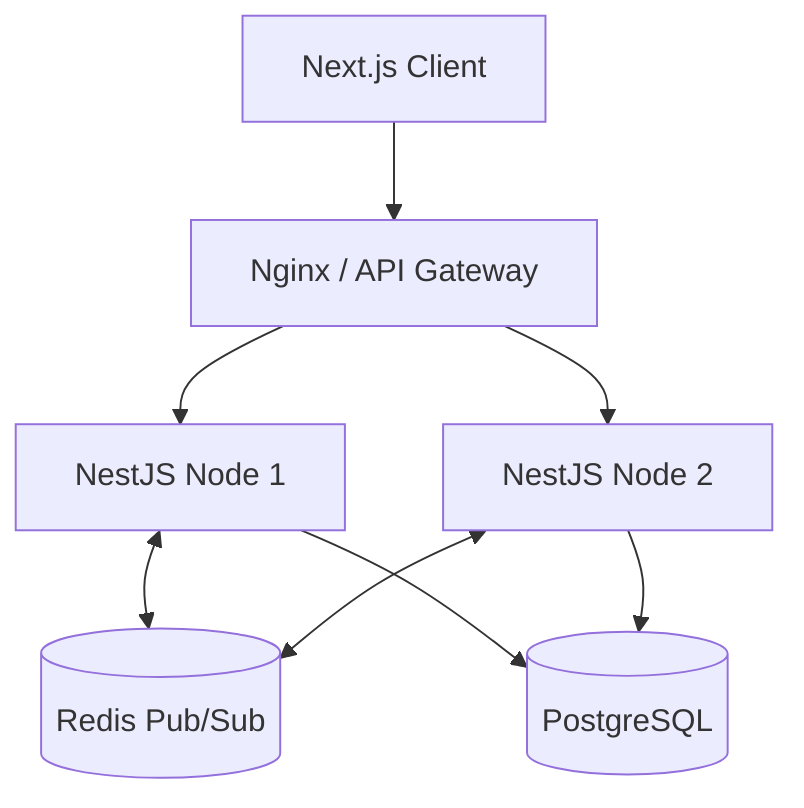

# Final Master Project: Enterprise SaaS Platform

## Project Overview
This is the culmination of the entire course. You will build a multi-tenant Project Management SaaS (similar to Linear or Asana) using a modern enterprise stack.

## Tech Stack
- **Frontend:** React, Next.js, TypeScript, Tailwind, React Query.
- **Backend:** NestJS (TypeScript), GraphQL or REST.
- **Database:** PostgreSQL, Prisma ORM.
- **Caching & PubSub:** Redis (for real-time WebSockets).
- **Infrastructure:** Docker, Docker Compose, Nginx, GitHub Actions.

## Requirements

### Multi-Tenancy
The core challenge. Users belong to Workspaces. All queries must be scoped to the user's workspace. Missing this is a critical security flaw.

### Real-time Collaboration
When User A moves a task on the Kanban board, User B must see it update instantly without refreshing.
- Implement WebSockets using Redis Pub/Sub to sync state across multiple backend instances.

### Comprehensive Testing
- **Unit Tests:** Jest for business logic.
- **Integration Tests:** Supertest for API endpoints (with a test database).
- **E2E Tests:** Cypress or Playwright for critical user flows (Login, Create Task, Move Task).

### Deployment & CI/CD
- Write a GitHub Actions workflow that:
  1. Lints code.
  2. Runs tests.
  3. Builds Docker images.
  4. Pushes to a container registry.
- Deploy to a VPS or AWS using Docker Swarm or Kubernetes.

## Architecture Diagram

## Grading Rubric
- **Security:** No IDOR vulnerabilities, proper JWT handling, rate limiting.
- **Performance:** N+1 query problems solved in Prisma, proper database indexing.
- **Code Quality:** strict TypeScript, modular architecture, comprehensive tests.
