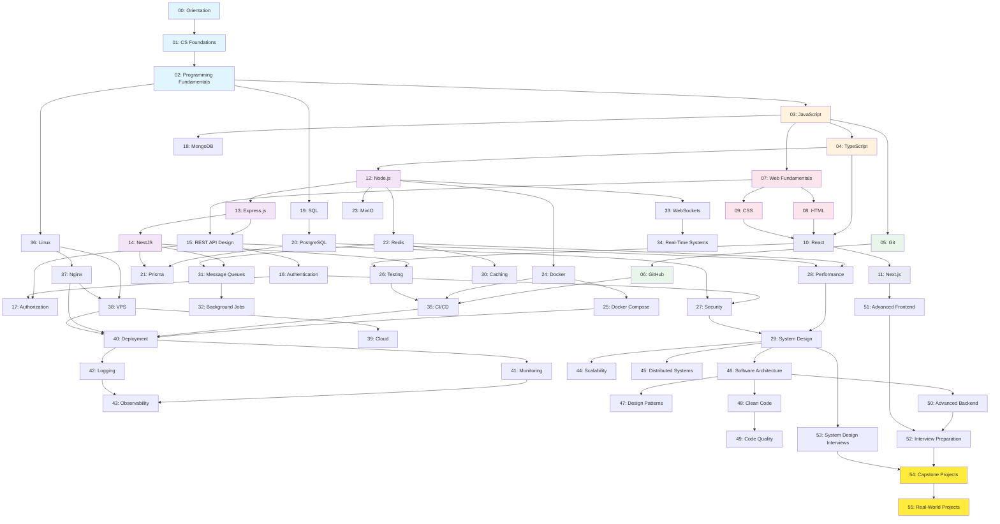
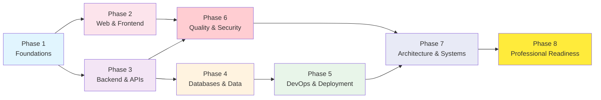

# 🗺️ Course Map — Dependency Graph

This document shows how modules depend on each other. **Do not skip prerequisites.**

---

## Visual Dependency Graph



---

## Phase Dependencies



---

## Module Categories

### 🔵 Foundations (Blue)
Modules 00-02: Computer science, programming basics

### 🟠 Languages (Orange)
Modules 03-04: JavaScript, TypeScript

### 🟢 Version Control (Green)
Modules 05-06: Git, GitHub

### 🔴 Web & Frontend (Red/Pink)
Modules 07-11: Web fundamentals, HTML, CSS, React, Next.js

### 🟣 Backend (Purple)
Modules 12-17: Node.js, Express, NestJS, REST APIs, Auth

### 🟡 Databases (Yellow/Orange)
Modules 18-23: MongoDB, SQL, PostgreSQL, Prisma, Redis, MinIO

### 🟢 DevOps (Green)
Modules 24-25, 35-43: Docker, CI/CD, Linux, Nginx, Deployment, Monitoring

### 🔴 Quality (Red)
Modules 26-28: Testing, Security, Performance

### 🔵 Architecture (Indigo)
Modules 29-34, 44-51: System Design, Caching, Queues, Scalability, Patterns

### 🟡 Professional (Gold)
Modules 52-55: Interviews, Capstone Projects

---

## Recommended Parallel Tracks

Once you complete Phase 1 (Foundations), you can study some modules in parallel:

### Track A: Frontend Path
```
07 → 08 → 09 → 10 → 11 → 51
```

### Track B: Backend Path
```
12 → 13 → 14 → 15 → 16 → 17 → 50
```

### Track C: Database Path
```
19 → 20 → 18 → 21 → 22 → 23
```

### Track D: DevOps Path
```
05 → 06 → 24 → 25 → 36 → 37 → 38 → 35 → 40
```

> **Note**: Tracks A and B can be studied simultaneously after Phase 1. Track C requires some backend knowledge. Track D can start after Git basics.
