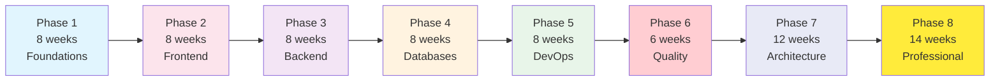

# 🗓️ Roadmap & Timeline

## Detailed Study Roadmap

This document provides a detailed timeline and milestone roadmap for completing the Full-Stack Engineering Course.

---

## 📊 Timeline Overview

---

## Phase 1: Foundations (Weeks 1-8)

### Milestones
- [ ] Can explain how the Internet works (DNS, HTTP, TCP/IP)
- [ ] Can write JavaScript programs with functions, arrays, objects
- [ ] Can use async/await and Promises
- [ ] Can write TypeScript with generics and utility types
- [ ] Can use Git for version control with branching strategies
- [ ] Can collaborate on GitHub with PRs and issues

### Weekly Goals
| Week | Focus | Deliverable |
|------|-------|-------------|
| 1 | Orientation + CS Foundations | Environment setup complete |
| 2 | CS Foundations (networking, web) | Can trace an HTTP request |
| 3 | Programming Fundamentals | Can write pseudocode for problems |
| 4 | JavaScript (basics → functions) | Calculator project |
| 5 | JavaScript (arrays, objects, async) | Weather app project |
| 6 | JavaScript (advanced + modules) | Expense tracker project |
| 7 | TypeScript | Type-safe utility library |
| 8 | Git + GitHub | Team workflow simulation |

---

## Phase 2: Web & Frontend (Weeks 9-16)

### Milestones
- [ ] Can explain the browser rendering pipeline
- [ ] Can build responsive layouts with Flexbox, Grid, Tailwind
- [ ] Can build React applications with hooks, state, and effects
- [ ] Can build Next.js applications with SSR, routing, and API routes
- [ ] Can integrate APIs with TanStack Query

### Weekly Goals
| Week | Focus | Deliverable |
|------|-------|-------------|
| 9 | Web Fundamentals | HTTP knowledge assessment |
| 10 | HTML (semantic, accessible) | Multi-page HTML site |
| 11 | CSS (layout, responsive) | Portfolio landing page |
| 12 | CSS + Tailwind | Dashboard layout |
| 13 | React (components, state, effects) | Todo app |
| 14 | React (hooks, patterns, TanStack Query) | Movie search app |
| 15 | Next.js (routing, server components) | Blog with Next.js |
| 16 | Next.js (data fetching, auth) | Dashboard with Next.js |

---

## Phase 3: Backend & APIs (Weeks 17-24)

### Milestones
- [ ] Can build REST APIs with Express.js
- [ ] Can build modular backends with NestJS and DI
- [ ] Can design APIs following REST best practices
- [ ] Can implement JWT authentication and RBAC authorization

### Weekly Goals
| Week | Focus | Deliverable |
|------|-------|-------------|
| 17 | Node.js (runtime, event loop) | CLI tool |
| 18 | Node.js (streams, modules) | Stream processing app |
| 19 | Express.js (routing, middleware) | Todo API |
| 20 | Express.js (auth, validation) | Blog API |
| 21 | NestJS (modules, controllers, services) | Task API |
| 22 | NestJS (DI, pipes, guards) | Protected API |
| 23 | REST API Design | API specification document |
| 24 | Authentication + Authorization | Complete auth system |

---

## Phase 4: Databases & Data (Weeks 25-32)

### Milestones
- [ ] Can write complex SQL queries with joins, CTEs, subqueries
- [ ] Can design normalized database schemas
- [ ] Can use Prisma for type-safe database access
- [ ] Can implement caching with Redis
- [ ] Can manage file storage with MinIO

### Weekly Goals
| Week | Focus | Deliverable |
|------|-------|-------------|
| 25 | SQL fundamentals | Query challenge set |
| 26 | PostgreSQL (advanced types, indexes) | Database for blog platform |
| 27 | MongoDB | Document database for analytics |
| 28 | Prisma (schema, CRUD, relations) | Prisma-backed API |
| 29 | Prisma (advanced, NestJS integration) | Complete data layer |
| 30 | Redis (data types, caching) | Caching layer |
| 31 | Redis (sessions, rate limiting) | Rate limiter |
| 32 | MinIO (uploads, presigned URLs) | File upload system |

---

## Phase 5: DevOps & Deployment (Weeks 33-40)

### Milestones
- [ ] Can containerize applications with Docker
- [ ] Can create multi-service environments with Docker Compose
- [ ] Can write CI/CD pipelines with GitHub Actions
- [ ] Can deploy to a VPS with Nginx and SSL

### Weekly Goals
| Week | Focus | Deliverable |
|------|-------|-------------|
| 33 | Docker (images, containers) | Containerized Node app |
| 34 | Docker Compose | Full-stack dev environment |
| 35 | Linux (filesystem, permissions, SSH) | Server administration skills |
| 36 | Nginx (reverse proxy, SSL) | Multi-app Nginx config |
| 37 | CI/CD (GitHub Actions) | Complete CI/CD pipeline |
| 38 | VPS + Deployment | Deployed application |
| 39 | Cloud fundamentals | Cloud architecture document |
| 40 | Monitoring + Logging + Observability | Monitoring dashboard |

---

## Phase 6: Quality & Security (Weeks 41-46)

### Milestones
- [ ] Can write unit, integration, and E2E tests
- [ ] Can identify and prevent OWASP Top 10 vulnerabilities
- [ ] Can optimize frontend and backend performance

### Weekly Goals
| Week | Focus | Deliverable |
|------|-------|-------------|
| 41 | Testing (unit, mocking) | Test suite for API |
| 42 | Testing (integration, E2E) | Playwright test suite |
| 43 | Security (OWASP, XSS, CSRF) | Security audit report |
| 44 | Security (auth, headers, secrets) | Hardened application |
| 45 | Performance (frontend) | Lighthouse score > 90 |
| 46 | Performance (backend, database) | Optimized API |

---

## Phase 7: Architecture & Systems (Weeks 47-58)

### Milestones
- [ ] Can design scalable systems on a whiteboard
- [ ] Can identify and apply appropriate design patterns
- [ ] Can implement real-time features with WebSockets
- [ ] Can architect production-grade applications

### Weekly Goals
| Week | Focus | Deliverable |
|------|-------|-------------|
| 47 | System Design (fundamentals) | Design document |
| 48 | System Design (caching, queues) | Caching strategy doc |
| 49 | Message Queues + Background Jobs | Job queue implementation |
| 50 | WebSockets + Real-Time | Chat application |
| 51 | Scalability + Distributed Systems | Scaling strategy doc |
| 52 | Software Architecture | Architecture decision records |
| 53 | Design Patterns | Pattern implementations |
| 54 | Clean Code + Code Quality | Refactored codebase |
| 55 | Advanced Backend | Production patterns |
| 56 | Advanced Frontend | Advanced React patterns |

---

## Phase 8: Professional Readiness (Weeks 59-72)

### Milestones
- [ ] Can answer technical interview questions confidently
- [ ] Can design systems in a system design interview
- [ ] Can build production-grade full-stack applications
- [ ] Portfolio contains 3+ impressive projects

### Weekly Goals
| Week | Focus | Deliverable |
|------|-------|-------------|
| 59-60 | Interview Preparation | Mock interview practice |
| 61-62 | System Design Interviews | 5 system designs completed |
| 63-66 | Capstone Project 1 | E-commerce platform |
| 67-70 | Capstone Project 2 | SaaS application |
| 71-72 | Final Master Project | Production deployment |

---

## 🎓 Graduation Criteria

To "graduate" from this course, you should be able to:

1. [ ] Build a full-stack application from scratch
2. [ ] Design a database schema for a complex system
3. [ ] Write secure, tested, production-ready code
4. [ ] Deploy and monitor an application on a VPS
5. [ ] Design a scalable system architecture
6. [ ] Pass a technical interview for a Full-Stack Engineer role
7. [ ] Contribute to a team codebase using Git workflows
8. [ ] Debug production issues using logs and metrics

---

*Adjust the timeline based on your pace. Quality > speed.*
