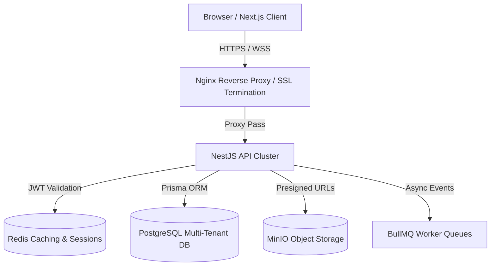

# 🚀 Production Capstone Systems
> **Scope:** Enterprise Multi-Tenant SaaS, Global LMS, High-Frequency Auction Platform

---

## Project Specification & Architecture Guide

### Executive Summary
Each project in this directory is engineered to meet production standards rather than demo-toy implementations. Code must include error boundaries, runtime schema validation (Zod), comprehensive test suites, and containerized Docker environments.

---

### Project Blueprint: High-Performance Multi-Tenant System

### Required Deliverables
1. **Source Code:** Modular NestJS or Express backend + Next.js 14 App Router frontend.
2. **Database:** Docker Compose setup with PostgreSQL and Redis with automated migrations.
3. **Storage:** MinIO bucket configured with private access policies and presigned upload URLs.
4. **CI/CD:** GitHub Actions workflow executing linting, unit tests, and Docker container build.
5. **Documentation:** OpenAPI/Swagger interactive UI and deployment runbook.
